# CCM: Composite Cognitive Model
## An orchestration architecture for composing models, agents, and workflows

> **Scope:** this author-approved manuscript reports the 10 October 2026 evidence
> cutoff. The packaged implementation also includes authenticated MCP, supervised
> async operations, permission-controlled native tools and conversation-wide
> improvement. Use the [current runtime documentation](../README.md) and
> [verification record](../TEST_RESULTS.md) for installation and current behavior;
> the paper's dated test counts are not current release acceptance claims.

**Document control**

| Field | Record |
|---|---|
| Author | TÖRE ÇAĞRI UYAR |
| Version | 1.0 (author-approved manuscript) |
| Date | 22 October 2026 — author approval |
| Status | Author-approved; not peer-reviewed, published, accepted by a journal, or assigned a DOI |
| Evidence cutoff | 10 October 2026 |
| Initial draft | 10 October 2026 |
| License | MIT (repository; © 2026 TÖRE ÇAĞRI UYAR) |

## Abstract

Composite Cognitive Model (CCM) is an architectural abstraction for presenting
heterogeneous language-model inference and agentic execution through a unified
client interface. It distinguishes three complementary forms of composition:
Mixture of Models (MoM), Mixture of Agents (MoA), and Mixture of Workflows (MoW).
The Foreman coordinates task interpretation, delegation, and user-facing
composition; dedicated generators create reusable definitions, while an Evaluator
assesses execution evidence and proposes definition-level changes. The current
implementation, CCM, provides an OpenAI-compatible chat-completions interface,
configurable provider/model resolution, dynamically generated specialists, bounded
workflow graphs, client-executed tool continuations, and post-response improvement
jobs. Shared provider admission controls concurrency and outage recovery across
foreground and background inference. This paper describes the implemented
contracts, separates them from planned extensions, and reports engineering
verification rather than comparative intelligence benchmarks. CCM does not imply
model-weight adaptation, learned mixture gating, or guaranteed improvements in
answer quality. Its contribution here is a documented composition architecture
and an inspectable implementation, not an experimentally established superiority
claim.

**Keywords:** language-model orchestration; multi-agent systems; workflow synthesis;
model routing; evaluation; inference admission control.

## AI-use disclosure

AI assistance was used in drafting, editing, and organizing this manuscript. The
author reviewed and approved the current manuscript (version 1.0, 22 October 2026).
AI systems are not authors and are not credited with independent verification or peer
review. Responsibility for the manuscript and its claims remains with the author.

## 1. Scope and terminology

CCM is the product and architectural name. Foreman is the main agent: the
coordinating and speaking role, not the complete server. The implementation includes
deterministic validation, scheduling, persistence, transport, and execution machinery
outside the Foreman role.

“Cognitive” describes task-oriented composition, not consciousness or a validated
theory of human cognition. “Model” in Composite Cognitive Model describes the
external abstraction: a client sends a request to one service, which may perform
multiple internal inference calls. It does not describe a newly trained neural
network or imply that all internal calls use one set of weights.

“Mixture” has a specific local meaning:

| Term | Meaning in CCM | Not implied |
|---|---|---|
| MoM | Selection and use of configured providers/models across operations and agents | Weight averaging, learned expert gating, or an optimal per-call router |
| MoA | Selection, generation, execution, and revision of reusable specialist definitions | Mandatory parallel answer ensembles or unrestricted autonomous processes |
| MoW | Selection and synthesis of executable stage graphs | Learned workflow weights or simultaneous execution of several workflows |

These terms identify views of a shared orchestration process, not three independent
services. A workflow stage executes an agent, whose inference resolves to a model
and provider. Foreman, generators, and Evaluator also use resolved inference calls.



**Figure 1.** Implemented composition relationships. MoA and MoW use MoM through
shared model resolution; the same applies to internal roles. Return paths,
validation, and persistence are abbreviated. An ordinary answer passes through
Foreman composition; client-tool handoffs follow a separate continuation protocol.
[Interactive figure](figures/01-composition.html).

## 2. Context and relation to existing work

Multi-agent orchestration is not unique to CCM. AutoGen describes customizable
conversable agents, tools, and programmable interaction patterns [1]. Accordingly,
this paper does not characterize all other frameworks as static agent farms or
claim that dynamic coordination is novel in itself.

The established Mixture-of-Agents formulation of Wang et al. uses layers of LLM
agents that consume outputs from the preceding layer [2]. CCM retains the MoA
term as requested architectural terminology, but uses it more broadly for
specialist composition. CCM does not currently implement that paper's layered
parallel aggregation as a mandatory inference algorithm, and its results cannot
be inferred from that work's benchmarks.

Sparse neural Mixture-of-Experts layers use a trainable gate to select neural
experts [3]. CCM operates at the service/orchestration level instead: messages,
definitions, stage transitions, and provider calls are composed without modifying
model parameters. MoM and MoW are operational definitions in this paper, not claims
to have introduced these phrases or established a new formal model family.

The proposed architectural emphasis is the conjunction of a unified interface,
generated reusable definitions, executable workflow validation, separated
evaluation authority, and explicit operational boundaries. Establishing novelty
requires a broader related-work review; demonstrating benefits requires controlled
comparisons. Neither is replaced by the engineering tests reported below.

## 3. System decomposition

The implementation is a Rust service with an HTTP API, a browser dashboard, a
SQLite-backed portfolio, an asynchronous execution runtime, and HTTP inference
providers. These are properties of the CCM implementation, not mandatory technologies
of CCM.

| Component | Responsibility | Authority boundary |
|---|---|---|
| Foreman | Interpret requests, select operations, delegate, compose the final answer | Does not own semantic quality verdicts or directly replace generator roles |
| Agent generator | Produce complete reusable specialist definitions | Output is validated and registered by server machinery |
| Workflow generator | Produce explicit stage graphs and requirements for dependencies | Referenced agents and graph structure must pass validation |
| Evaluator | Judge observed work; propose keep, revise, or retire | Evidence and complete replacement definitions are required; application is guarded |
| Runtime/registry | Execute decisions, check authority, maintain versions and continuations | Model text does not directly mutate storage or authorize arbitrary tools |
| Provider layer | Resolve routing, enforce budgets, queue calls, stream responses | No silent substitution of another provider on failure |
| Improvement worker | Process released post-response jobs | One job at a time; distinct from general background-agent delegation |

The current implementation distinguishes model-generated intent from executable
authority. A structurally valid routing decision is checked against the active
roster and available operations before dispatch. Runtime checks remain necessary
because state can change between selection and execution.

## 4. Mixture of Agents

### 4.1 Definitions, generation, and reuse

An agent is a stored specialist definition invoked by the runtime, not necessarily
a persistent process. The system can begin without a prepopulated task-specific
workforce, but it has built-in roles and fallback behavior. Existing agents can
be reused; generation is policy-controlled rather than mandatory for every task.

Generated agents require seven nonempty provisions: **identity, mission, method,
boundaries, task context, capabilities, and output contract**. The server verifies
their presence and composes the executable prompt. Presence checks do not establish
semantic quality. In particular, text in a capabilities provision does not create
an executable tool or authorize its use.

Generation targets a reusable class of work rather than embedding a single task
as the agent's permanent purpose. Registry logic handles validation, consolidation,
registration, and versioned changes. Automatic creation timing can occur before
or after execution according to configured policy and eligible saved preferences.
Policies do not imply unconstrained generation or an unlimited internal-operation
budget.



**Figure 2.** Creation path and later evaluation. Reusing an existing definition
bypasses generation. The evaluation arrow represents a held job released after
successful response completion, not synchronous evaluation in the answer path.
Revisions affect future selection; active executions retain their snapshots.
[Interactive figure](figures/02-agents.html).

### 4.2 Execution and composition

A specialist receives the effective task context and the capabilities actually
provided. It can return a report or issue a permitted client-tool call. Foreman
composes the user-facing answer from execution evidence and the original task
constraints. A fallback path is also available; not every request needs a new
agent or workflow.

Composition is itself inference and can introduce errors even when the specialist
report is correct. A unified speaker is therefore an interface property, not a
guarantee of faithful synthesis. This failure mode is retained in the evidence
discussion rather than hidden by successful routing tests.

## 5. Mixture of Workflows

### 5.1 Graph contract

A workflow contains a name, purpose, entry stage, bounded `max_steps`, and a list
of stages. Each stage identifies an agent and instruction, optionally followed by
ordered branches and a default transition. Each branch compares a JSON pointer
in the parsed stage report against a specified JSON value. The first exact match
wins; otherwise the default transition applies. A null successor terminates.

For a workflow W, let s_t be the active stage and r_t its report. Its transition
is a deterministic function of the stored graph and the report:

```text
s_(t+1) = first matching branch successor in W(s_t, r_t)
          or W's default successor for s_t
```

The report is model-generated, so deterministic transition evaluation does not
make the overall task deterministic. Branch stages must produce parseable JSON.
The graph validator checks stage IDs, transitions, entry membership, and bounds;
referenced agent IDs must resolve to active definitions. Both stage count and
`max_steps` are bounded by 100. Cycles are permitted, but budget exhaustion is an
explicit failure rather than successful completion.



**Figure 3.** Control-flow graph for the executor, not a prescribed domain workflow.
Only one stage is active within a workflow. A tool pause retains the stage and
resumes after matching client results; its return edge is described here rather
than drawn across the stage-transition graph. Parallel fan-out/join remains
unimplemented. [Interactive figure](figures/03-workflows.html).

### 5.2 Context and continuation

Stages receive the original request and previous stage outputs. Workflow and agent
definitions are snapshotted to prevent a concurrent revision from silently changing
an in-progress execution. A client-tool request persists continuation state and
returns control to the originating client; the server checks expected tool-call
IDs and ownership before resuming. This is a suspended execution protocol, not a
server-side execution of the client's tools.

MoW therefore includes dynamically synthesized but explicitly executable graphs.
It does not currently mean arbitrary distributed DAG scheduling, concurrent
workflow ensembles, or a learned optimizer over workflow alternatives.

## 6. Mixture of Models

### 6.1 Configured routing and assignment

Clients choose an exposed model ID. Omission selects the configured default;
unknown IDs are rejected. An exposed model resolves to an actual provider/model
pair and operational settings. Agent definitions and explicit role/agent overrides
can select different providers/models for different operations.

Conceptually, resolution applies increasingly specific values:

```text
built-in/environment baseline → global file → selected exposed model
→ nonempty stored agent assignment → explicit agent/role overrides
```

Within explicit agent overrides, selected-model declarations are applied after
global declarations, and an ID match takes precedence over a name match within
each map. Unset fields inherit. Database location and shared memory budget remain
global. Request/call snapshots preserve the selected execution configuration;
current process-wide admission settings still govern provider access.

An optional, separate `agent_models` catalog provides provider/model IDs, context
metadata, capabilities, and selection rationale for generation or revision.
Foreman supplies creation requirements and may express a preferred catalog choice;
the generator emits the assignment, and Evaluator may propose reassignment when
revising a definition. Choices are validated against the catalog. The catalog is
not necessary for exposing client models, and its metadata is not independently
verified capability evidence.



**Figure 4.** Configuration and assignment feed resolved calls, which all pass
through shared provider admission. The catalog arrow represents a stored
generation/revision choice, not a fresh optimization at every inference call.
[Interactive figure](figures/04-models.html).

### 6.2 Concurrency and provider recovery

For a configured provider p with concurrency limit L_p, admission enforces:

```text
active inference calls for p ≤ L_p
```

This is a per-process, per-provider-ID invariant. Separate aliases for the same
endpoint do not share a gate automatically, and multiple CCM processes do not
coordinate distributed capacity. Omitted limits mean unlimited concurrency.

The slot covers the full HTTP response stream. Queuing, retry backoff, and cooldown
do not hold an active slot; waiting remains cancellable and counts against the
total call budget. These rules apply across foreground tasks and background work,
not merely within one workflow.

Transient transport failures and non-success HTTP responses open a shared circuit.
Default recovery begins with a 30-second cooldown, increasing exponentially up to
five minutes; a longer `Retry-After` remains a lower bound. Once cooldown ends and
existing active calls drain, one waiting real request probes recovery. Success
releases queued work subject to capacity. A failed probe extends cooldown. Circuit
state is memory-resident and resets on restart.

Per-call transport retries remain bounded independently. Admission does not replay
client-visible output or authorize unlimited evaluation attempts. Improvement jobs
that time out while waiting for admission return to the queue; actual provider
retry exhaustion can still produce a failed job. The single improvement worker
can exhibit head-of-line blocking while waiting for a provider.

## 7. Routing contracts and tool boundaries

Foreman returns an internal decision contract rather than directly executing
arbitrary model-authored instructions. Supported decisions select an agent,
workflow, fallback, authorized creation, or an available internal operation.

Provider JSON-schema enforcement is an explicit provider capability setting and
applies to **Foreman routing**, not all outputs. Regardless of provider enforcement,
local validation checks the entire JSON decision, available references, argument
shape, and policy-allowed variants. There are at most two corrective generations
after the initial generation, sharing one total routing budget. Transport retries
may occur within those generations. Invalid-attempt reasoning is buffered rather
than exposed to the client.

Schema validity is not task correctness. A schema can ensure a selected agent ID
exists without ensuring that agent is a good choice. Specialist, generator,
Evaluator, and final-composition outputs do not automatically inherit the routing
schema setting; they retain their respective prompt and parsing contracts.

The implemented tool boundary comprises client-supplied tool passthrough and
defined internal orchestration operations. MCP client consumption, Foreman-selected
server-tool grants, and general filesystem/shell/HTTP execution are not implemented
as described by the original brief. Native execution remains contingent on a
sandboxing design. Tool descriptions, availability, authorization, and actual
execution must be distinguished throughout future extensions.

## 8. Contextual evaluation and background work

Automatic improvement captures the executed definition, task evidence, and report
in a held job. Successful API response-body completion releases eligible jobs;
native chat releases after persistence/publication of the assistant message.
Tool handoffs do not release the improvement work. Failed composition or discarded
responses cancel held work. This is a server-observed publication boundary, not
proof that a remote user read the result.


**Figure 5.** Implemented post-response improvement path. The dashed edge identifies
a planned conversation-wide scheduling extension, not an active runtime path.
Explicitly requested evaluations and task-required checking stages may run on the
foreground path; the separation shown concerns automatic improvement.
[Interactive figure](figures/05-improvement.html).

Evaluator produces an evidence-bearing keep/revise/retire decision. Definition
mutations are guarded against stale versions and reset generations; completion
receipts prevent an already committed improvement from being applied twice.
Retirement removes a definition from future selection without erasing its history.
Pending execution snapshots remain distinguishable from live definitions.

Current automatic evaluation is **request-scoped**. A request may contain prior
conversation messages, and workflow evidence includes stage outputs, but this
does not establish exhaustive evaluation of all logs, corrections, malformed
calls, or the full lifetime of a conversation. Internal briefs retain message
roles and preserve important instructions, while a soft size guard can remove
older dialogue. Adaptive conversation-wide checkpoints and feedback screening
remain planned.

“Improvement” refers to the mechanism for changing reusable definitions. Its
existence does not prove that every revision improves quality. Underlying model
weights are unchanged. Evaluator bias, incomplete evidence, and regression after
revision require independent measurement.

## 9. Interface, visibility, and persistence

The CCM implementation provides an OpenAI-compatible subset including
`POST /v1/chat/completions`
and `GET /v1/models`, streamed and buffered answers, and client-tool continuations.
This is an existing API, not merely a conceptual endpoint. The illustrative
identifier `ccm-1` is not a shipped model ID or a declared model version. Compatibility
should not be generalized to every OpenAI endpoint or extension.

The dashboard exposes execution and workforce views, traces, versions, and operator
controls. API client identity and selected model scope saved preferences; this
scoping must not be confused with a complete authentication/authorization system.
Native password/FIDO2 authentication was considered but is not currently requested.

`introvert`, `extrovert`, and `flexible` configure presentation. Flexible mode begins
introverted and can persist an explicit mode change for subsequent requests.
Ordinary narration is constrained by the final-output contract. Provider-returned
Foreman reasoning and labelled operational observations may be exposed separately
in extrovert mode. This is an observable output channel, not complete or necessarily
faithful access to an underlying model's internal computation. The current setting
does not establish a different reasoning algorithm, competence level, or tool
permission set.

CCM uses memory-first database operation and asynchronous persistence under a
shared configurable budget (256 MiB by default). Replay and dashboard buffering
are bounded separately from disk persistence. A successful in-memory mutation does
not imply an immediate disk flush; unpublished changes can be lost on process
failure. Recovery guarantees must be interpreted relative to the persisted state,
not as unconditional exactly-once execution of external tools.

## 10. Implementation status and evidence

| Capability | Status at cutoff | Qualification |
|---|---|---|
| Unified chat endpoint and Foreman composition | Implemented | API subset; composition remains fallible |
| Generated agents and workflows | Implemented | Validated, policy-controlled, reusable definitions |
| Heterogeneous model/provider assignments | Implemented | Configured inheritance and optional allowlisted catalog |
| Branches, cycles, client-tool continuation | Implemented | Single active workflow stage with finite budgets |
| Post-response improvement | Implemented | Sequential worker; request-scoped evidence |
| Shared concurrency and cooldown | Implemented | Per-process/provider ID; no distributed limiter |
| Flexible presentation personality | Implemented | Narration/thinking visibility, not competence adaptation |
| Parallel workflow stages | Not implemented | No fan-out/join executor |
| Supervised asynchronous delegation | Planned | Distinct from asynchronous I/O and improvement jobs |
| MCP consumption and per-agent server-tool grants | Planned | Connections and capability boundaries need implementation |
| Native filesystem/shell tools | Deferred | Sandboxing decision required |
| Conversation-wide adaptive improvement | Planned | Existing evaluator is not the complete proposed evidence pipeline |

The verification record at the cutoff reports **186 passing Rust tests and four
passing frontend state tests** after provider-admission integration. These test
counts are engineering evidence, not a task-success score or comparative model
benchmark. The [claim-to-code appendix](CLAIMS.md) identifies relevant contracts
and limitations. The source manifest identifies the packaged implementation by
content hash; it is not a reconstruction of every source file at the paper's cutoff.

Representative evidence includes:

- Controlled provider fixtures test full-stream capacity ownership, cross-call
  cooldown, cancelled queued clients, single-probe recovery, and provider isolation.
- Routing regressions test invalid decisions, bounded correction, policy/argument
  rejection, and suppression of failed-attempt output.
- Workflow regressions test graph validation, branch/cycle budgets and tool
  continuation. They do not establish optimal workflow synthesis.
- Live schema-enforcement checks succeeded on the tested local inference stack.
  A subsequent small-model smoke test passed routing but failed an exact-answer
  instruction during composition. This directly separates protocol success from
  answer quality.

No aggregate performance chart is presented: there is no controlled, repeated
benchmark dataset sufficient to support one. Historical single-run latency probes
are useful operational diagnostics but would not justify throughput, quality, or
speedup claims across models. Figures 1–5 are architectural graphs, not measured
performance curves.

## 11. Proposed evaluation methodology

This section is an experimental proposal, not completed research or an approved
implementation roadmap. A comparative study should specify a fixed task set,
model versions, decoding settings, tools, context budgets, concurrency limits,
hardware/provider conditions, and request/call snapshots. Report failed and
incomplete tasks rather than discarding them.

Useful comparisons include direct model inference, fixed-agent orchestration,
generated-agent orchestration, generated workflows, and catalog-guided heterogeneous
assignment. Control inference budgets; otherwise extra calls can confound any
apparent benefit. Separate initial generation cost from reuse performance.

Recommended measures are independently scored task success, format compliance,
unsupported-claim rate, calls/tokens per task, end-to-end latency distributions,
queue wait, recovery probe volume, and revision regressions. Evaluator verdicts
alone should not serve as ground truth for evaluating that same evaluator.

Future quantitative figures could show quality–cost trade-offs, latency distributions,
and request rate during controlled provider outages, with repeated trials and
uncertainty intervals. No such figures should be populated with invented values.

## 12. Limitations and future work

The present work describes a working architecture and its contracts, not a proven
general-purpose cognitive advantage. Quality depends on provider capabilities,
prompt adherence, routing decisions, workflow synthesis, and composition fidelity.
Syntactic constraints reduce protocol failures but cannot ensure correct task
interpretation. Reusable definition revision can preserve or introduce errors.

General asynchronous delegation, server-side MCP tools, and full-conversation
evaluation remain explicit extensions. Parallel workflow execution would require
new synchronization, continuation, cancellation, and provenance contracts. Broader
deployment work includes authentication boundaries, bounded multi-tenant admission,
and restart behavior; none is implied by preference scoping or a provider semaphore.

The current evidence does not establish unbounded context support, general native
tool-call support for every configured model, sustained-load behavior across all
providers, or external side-effect exactly-once semantics. Source-level assertions,
controlled regressions, live probes, and research hypotheses are kept separate.

## 13. Conclusion

CCM describes an inference-facing composition architecture in which a Foreman
coordinates reusable specialists, executable workflows, and heterogeneous model
calls. CCM demonstrates a concrete implementation of those mechanisms with
validated routing, bounded execution, explicit client-tool continuations,
post-response definition evaluation, and shared provider admission. The principal
claim is architectural coherence and inspectable execution boundaries. Demonstrating
comparative quality, efficiency, or adaptive benefit remains empirical work.

## Revision history and changes

| Version | Date | Record |
|---|---|---|
| 0.1 | 10 October 2026 | Initial implementation-grounded draft with five architecture figures. Evidence cutoff: 10 October 2026. |
| 1.0 | 22 October 2026 | Author-reviewed and approved version. Editorial status, identity, disclosure, and document-control changes only; no new experiments, source inspection, or test run. |

**Changes in version 1.0.** The draft and author-review-pending labels were removed
following the author's approval. The product is CCM, with Foreman as
the main agent. This version
adds document control, this revision record, a reproducibility statement, and the
AI-use disclosure above. The scientific claims, evidence cutoff, figures, historical
test counts are tied to the stated evidence cutoff.

Version 1.0 is an editorial label for the author-approved manuscript, not a software
release tag, journal version, DOI deposit, or Git commit identifier.

## Reproducibility and artifact availability

The manuscript package includes the [claim-to-code appendix](CLAIMS.md), the
[bibliography](references.bib), figure specifications and delivery receipts in
`figures/`, the [figure verification record](FIGURE_VERIFICATION.md), and a
[source manifest](source-manifest.json) of the packaged implementation files.
The manifest identifies current file contents by SHA-256. The test counts cited
in §10 are the recorded engineering results at that cutoff, not a new benchmark or a
claim about later builds.

The public package excludes local operational logs, credentials, client
conversations, private endpoints, and raw traffic exports. The repository is
[MIT licensed](../../LICENSE). No journal submission, peer-review outcome, or DOI is
asserted.

## References

1. Qingyun Wu et al. **AutoGen: Enabling Next-Gen LLM Applications via Multi-Agent
   Conversation.** 2023. [arXiv:2308.08155](https://arxiv.org/abs/2308.08155).
2. Junlin Wang, Jue Wang, Ben Athiwaratkun, Ce Zhang, and James Zou.
   **Mixture-of-Agents Enhances Large Language Model Capabilities.** 2024.
   [arXiv:2406.04692](https://arxiv.org/abs/2406.04692).
3. Noam Shazeer et al. **Outrageously Large Neural Networks: The Sparsely-Gated
   Mixture-of-Experts Layer.** 2017.
   [arXiv:1701.06538](https://arxiv.org/abs/1701.06538).

Bibliographic records and abstracts were checked against the linked arXiv pages.
These references position terminology; their experimental results are not evidence
for CCM. See [references.bib](references.bib) for citation entries.
